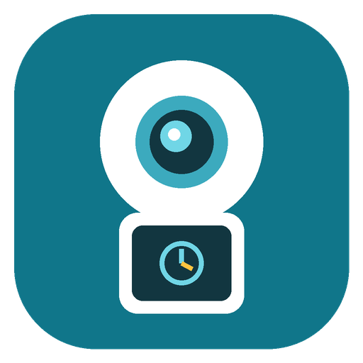

<p align="center">
  
</p>

# Dosen Pro

Biến **màn hình, loa, mic và camera** của camera gọi video **DOSEN RPO V1** (app iCSee / XM, màn hình 2,8") thành một thiết bị
đa dụng cho Home Assistant:

- **Màn hình**: đồng hồ đầy đủ (giờ lớn, âm lịch, Can Chi, ngày lễ sắp tới, thời tiết), ảnh, video, camera trực tiếp; chiếu hội thoại
  Assist, tên người gọi Zalo, chuông cửa… theo **lớp sự kiện**, xong thì tự về màn hình mặc định.
- **Vệ tinh Assist** gốc của HA: nghe mic camera, hỏi đáp bằng từ khoá đánh thức, đọc câu trả lời ra loa, hiện chữ hội thoại lên màn.
- **Loa** (`media_player`): phát TTS, nhạc, URL ra loa camera.
- **Camera** (`camera`): hình và tiếng của chính camera qua RTSP, dùng cho Frigate, go2rtc, cuộc gọi Zalo…
- **Bộ đàm** cho cuộc gọi Zalo: tiếng người bên kia ra loa camera theo thời gian thật.

**Chạy thẳng trong Home Assistant, không cần Docker hay dịch vụ nào khác** (HAOS, Container, Core đều được). Tích hợp nói chuyện
trực tiếp với camera qua giao thức DVRIP (cổng 34567), dùng ffmpeg và Pillow có sẵn của HA; phông DejaVu kèm theo trong tích hợp.
Đã thử trên Home Assistant 2026.11.

| Phần | Thư mục | Là gì |
|---|---|---|
| Tích hợp HA | `custom_components/dosen_pro/` | Thực thể, dịch vụ, Assist, camera, bộ đàm |
| Lõi DVRIP | `custom_components/dosen_pro/dosen_core/` | Thuần Python, không phụ thuộc HA: màn hình (AVTalk), loa, mic, báo động, lịch âm, vẽ màn hình |
| Blueprint | `blueprints/automation/dosen_pro/` | Chiếu video, camera, cuộc gọi Zalo lên màn; nút gọi |
| Biểu tượng | `custom_components/dosen_pro/brand/` | Icon sáng/tối cho HA |

## Cài đặt

1. **HACS** → ⋮ → Kho tuỳ chỉnh → `https://github.com/TriTue2011/Dosen-pro` (loại *Tích hợp*) → cài **Dosen Pro**.
   Không dùng HACS: chép thư mục `custom_components/dosen_pro` vào `/config/custom_components/`.
2. **Khởi động lại Home Assistant.** (Cập nhật bản mới cũng vậy: *Tải lại* tích hợp **không** nạp mã Python mới, phải khởi động lại.)
3. Cài đặt → Thiết bị và dịch vụ → Thêm tích hợp → **Dosen Pro** → điền **IP camera, cổng (34567), tài khoản và mật khẩu camera**.

> **Nên tạo một tài khoản riêng cho Dosen** trên camera (bằng phần mềm CMS của hãng). Camera **khoá tài khoản** nếu bị nhập sai mật khẩu
> nhiều lần (Ret 205); tích hợp tự chặn đăng nhập dồn dập khi camera từ chối để không kéo dài việc khoá.
> Đổi IP, tài khoản, mật khẩu về sau: ⋮ → **Cấu hình lại**. Hộp **Cấu hình** có hai tuỳ chọn: bật/tắt luồng sự kiện camera và địa chỉ HA
> dùng cho các đường dẫn ký sẵn.

## Thực thể

| Thực thể | Làm gì |
|---|---|
| `assist_satellite.dosen_pro` | Nghe mic camera, chạy pipeline Assist (từ khoá → nhận giọng → hiểu lệnh → trả lời), đọc câu trả lời ra loa. |
| `select.dosen_pro` / `select.dosen_pro_2` | Chọn pipeline Assist / độ nhạy nhận biết «nói xong». |
| `media_player.dosen_pro_loa` | `tts.speak`, `media_player.play_media` (URL, tệp, kho media) ra loa camera. |
| `camera.dosen_pro_camera` | Hình và tiếng của camera qua RTSP (luồng phụ 800×448 HEVC + tiếng G.711). |
| `number.dosen_pro_tang_mic` | Khuếch đại mic 0–30 dB (phần mềm) trước khi vào Assist. |
| `number.dosen_pro_am_luong_loa_camera`, `number.dosen_pro_am_luong_mic_camera` | Âm lượng loa và mic **của camera** (cài đặt thật, app iCSee cũng thấy). |
| `switch.dosen_pro_chong_on_mic_camera` | Chống ồn của mic camera. |
| `switch.dosen_pro_tieng_bip_khi_nhan_nut` | Tiếng bíp khi bấm phím trên thân camera (`KeyAudioTip`). |
| `switch.dosen_pro_tat_mic` | Tắt nghe (loa và màn hình vẫn chạy). |
| `switch.dosen_pro_hien_hoi_thoai_tren_man_hinh` | Bật/tắt việc hiện hội thoại Assist lên màn. |
| `select.dosen_pro_man_hinh_mac_dinh` | Loại màn hình mặc định: tắt, đồng hồ, ảnh, video lặp, camera trực tiếp. |
| `select.dosen_pro_camera_mac_dinh`, `select.dosen_pro_anh_mac_dinh`, `text.dosen_pro_dia_chi_mac_dinh` | Nguồn của màn mặc định: chọn **theo danh sách camera / ảnh của HA**, hoặc gõ địa chỉ. |
| `select.dosen_pro_thoi_tiet_tren_dong_ho` | Thực thể `weather.*` hiện trên đồng hồ. |
| `select.dosen_pro_xoay_hinh_mac_dinh`, `select.dosen_pro_kieu_khung_hinh_mac_dinh` | Xoay hình 0/90/180/270° và «vừa khung / lấp đầy» (chỉ cho màn mặc định). |
| `select.dosen_pro_chat_luong_hinh_tren_man` | Chất lượng mã hoá hình lên màn: Chuẩn / Cao / Cao nhất (thử). |
| `button.dosen_pro_bat_man_hinh`, `button.dosen_pro_tat_man_hinh` | Bật / tắt nguồn màn hình camera. |
| `button.dosen_pro_ve_man_hinh_mac_dinh`, `button.dosen_pro_dung_loa` | Gỡ mọi lớp sự kiện về màn mặc định; dừng loa. |
| `number.dosen_pro_thoi_gian_sang_man_hinh`, `number.dosen_pro_do_sang_man_hinh` | Thời gian màn sáng (0 = không tắt) và độ sáng 1–100%. |
| `sensor.dosen_pro_noi_dung_man_hinh` | Màn đang chiếu gì: `off`, `clock`, `image`, `video`, `live`, `text`. |
| `sensor.dosen_pro_muc_mic` | Mức tiếng mic (dBFS) đang đưa vào Assist, để chỉnh «Tăng mic». |
| `event.dosen_pro_su_kien_camera` | Mọi báo động camera đẩy tới (xem *Nút gọi*). |

## Màn hình

Màn hình hoạt động theo **lớp**:

- **Màn hình mặc định** (đặt ngay trên thiết bị, nhớ qua khởi động lại): đồng hồ, ảnh, video lặp hoặc camera trực tiếp. Khi khởi động HA,
  nếu nguồn chưa nạp kịp (ví dụ camera go2rtc) thì tự thử lại vài lần.
- **Sự kiện** (`dosen_pro.screen_show`, `screen_text` với `owner` và `ttl`): lớp **gần nhất đè lên**; hết video / hết `ttl` /
  `screen_release` thì về lớp bên dưới, hết lớp thì về màn hình mặc định. Cùng `owner` thì thay nhau, khác thì xếp chồng.
  Lớp sự kiện luôn hiện nguyên trạng (không xoay).
- **Assist** tự chiếu hội thoại (lớp `assist`). Chiếu video, camera, cuộc gọi Zalo… làm bằng **blueprint**.

Màn hình camera **chỉ hiện hình khi đang sáng**: mỗi lần mở phiên hiển thị, tích hợp tự bật nguồn màn (lệnh `OPScreenSwitchControl`).
Camera chỉ nhận **một phiên hiển thị** một lúc (phiên thứ hai bị từ chối, Ret 503).

### Đồng hồ

Bố cục dọc 240×320, vẽ lại mỗi phút và mỗi khi thời tiết đổi:

- thứ, ngày, **giờ lớn** (dấu hai chấm đỏ); chữ đen trên nền sáng, điểm nhấn đỏ, cho dễ đọc trên màn nhỏ;
- **ngày lễ sắp tới** và «Còn N ngày» (hoặc «Hôm nay», «Ngày mai»): ngày lễ dương lịch và âm lịch của Việt Nam, kể cả Giao thừa;
- **năm Can Chi**, ngày/tháng **âm lịch** cỡ lớn màu đỏ (có đánh dấu tháng nhuận; dương lịch đã ở dòng trên cùng), **số tuần**;
- **thời tiết**: biểu tượng (đổi theo ngày/đêm), nhiệt độ, tình trạng tiếng Việt, độ ẩm, thấp–cao trong ngày (lấy từ dự báo hằng ngày của
  thực thể, tự đổi °F sang °C). Chọn thực thể ở `select.dosen_pro_thoi_tiet_tren_dong_ho`; dự báo làm mới mỗi 30 phút.

Âm lịch tính ngay trong tích hợp (thuật toán thiên văn, múi giờ UTC+7), **không cần mạng hay tích hợp lịch khác**; đã đối chiếu với Tết 2024–2026,
Trung thu và Giỗ Tổ 2026, tháng nhuận 2025.

### Xoay hình và chất lượng

- **Xoay hình / kiểu khung** chỉ áp cho **màn hình mặc định** (ảnh, video, camera trực tiếp): xoay 90° để hình ngang vừa màn dọc,
  «lấp đầy» để cắt rìa thay vì chừa viền đen.
- **Chất lượng hình**: *Chuẩn* (mặc định, x265 ultrafast), *Cao* (cùng công cụ, chi tiết hơn khi chuyển động), *Cao nhất* (preset
  chậm hơn, đẹp nhất). **Mọi mức đều giới hạn kích thước từng khung hình ở khoảng 7,5 KB**: camera chỉ nhận gói media cỡ vài KB (app iCSee
  thật không gửi khung nào quá 5,8 KB; đo trên camera này cho thấy hiện được tới khoảng 8,4 KB, **đen từ khoảng 9,7 KB**). Vì vậy
  các mức chỉ khác nhau ở độ nén (crf) và preset, **không** khác ở tốc độ bit. Ảnh đứng yên như đồng hồ: khung đầu hơi mờ rồi vài khung
  sau tự làm nét. Nếu màn đen hoặc chập chờn thì đặt lại «Chuẩn».

## Assist và từ khoá đánh thức

Chọn một pipeline có **từ khoá đánh thức** (ví dụ openWakeWord) ở `select.dosen_pro`. Mic camera chất lượng điện thoại (8 kHz): nói cách
camera khoảng một mét; xem `sensor.dosen_pro_muc_mic` khi nói. **Đừng đặt «Tăng mic» quá cao** (khoảng 0–6 dB là đủ): tiếng bị cắt đỉnh
làm nhận giọng sai.

Để tìm lỗi nhận giọng, tích hợp lưu **lượt nói gần nhất** đúng như bộ nhận giọng nghe được vào `/config/dosen_pro_stt/last.wav`, kèm
`last.txt` (chữ nhận ra, đỉnh, tỉ lệ bị cắt đỉnh). Chỉ giữ một lượt, nằm trong thư mục cấu hình của HA.

## Cuộc gọi Zalo bằng camera Dosen

Dosen cung cấp đủ ba thứ cho tích hợp **Zalo Calling**:

- **Camera + mic**: chọn `camera.dosen_pro_camera` (RTSP có cả hình và tiếng);
- **Loa**: chọn `media_player.dosen_pro_loa`; tiếng người bên kia đi qua bộ đàm `POST /api/dosen_pro/intercom/<entry_id>?k=<khoá>`
  (G.711 A-law 8 kHz theo thời gian thật). Khoá riêng của mỗi thiết bị tự sinh và nằm trong dữ liệu mục cấu hình. Trong lúc có
  cuộc gọi, vệ tinh Assist ngừng nghe để tiếng cuộc gọi không kích hoạt từ khoá.
- **Hình từ điện thoại lên màn**: blueprint `man_hinh_cuoc_goi_zalo.yaml`.

> Phía Zalo Calling cần bản có hỗ trợ Dosen làm mic/loa; bản đó chưa có trong kho Zalo Calling công khai tại thời điểm phát hành này.

## Dịch vụ

`dosen_pro.screen_show` (nguồn: `camera_entity`, `media`, hoặc gõ `source`), `screen_text`, `screen_release`, `screen_default`,
`screen_off`, `screen_power`, `screen_sleep`, `speaker_play`, `speaker_stop`. Xem mô tả từng trường trong *Công cụ nhà phát triển → Dịch vụ*.

```yaml
# Chuông cửa: hình camera cửa lên màn, kèm tiếng chuông
- action: dosen_pro.screen_show
  data: {camera_entity: camera.cua, owner: chuong_cua, ttl: 30}
- action: dosen_pro.speaker_play
  data: {source: "http://homeassistant.local:8123/local/chuong.mp3"}

# Hiện hội thoại
- action: dosen_pro.screen_text
  data:
    title: "Trợ lý"
    messages:
      - {role: user, text: "Bật đèn phòng khách"}
      - {role: assistant, text: "Đã bật đèn."}

# TTS ra loa camera
- action: tts.speak
  target: {entity_id: tts.piper}
  data: {media_player_entity_id: media_player.dosen_pro_loa, message: "Có khách ở cửa"}
```

## Blueprint

Chép ba tệp trong `blueprints/automation/dosen_pro/` vào `/config/blueprints/automation/dosen_pro/` (hoặc nhập bằng đường dẫn raw).

| Blueprint | Làm gì |
|---|---|
| `man_hinh_su_kien.yaml` | Có sự kiện (chuông cửa, phát hiện người…) thì chiếu video / camera trực tiếp / ảnh / chữ lên màn, giữ N giây. |
| `man_hinh_cuoc_goi_zalo.yaml` | Cuộc gọi Zalo đến / đang gọi / đang nói chuyện hiện lên màn (tên người gọi, và hình video nếu điền địa chỉ). |
| `nut_goi_camera_zalo.yaml` | Bấm nút gọi: có cuộc gọi Zalo đến thì **nghe máy**, không thì **gọi Zalo đi** cho người đã chọn. |

## Nút gọi trên camera

Camera **tự xử lý** nút gọi (hiện màn gọi riêng của phần mềm camera) và, theo các lần đo, **không báo sự kiện nào qua mạng nội bộ**:
kênh báo động chỉ trả sự kiện phát hiện người. Để dò tiếp, mọi gói tin lạ camera đẩy ra (trên kênh báo động và hai kết nối của phiên màn hình)
đều hiện thành sự kiện `opcode_<số>` ở `event.dosen_pro_su_kien_camera` và trên bus HA dưới tên `dosen_pro_alarm`. Bấm nút rồi xem sự kiện nào
hiện ra; blueprint `nut_goi_camera_zalo` bắt sự kiện theo **tên bạn điền** (mặc định `LocalAlarm`, chưa được xác nhận trên camera này).
Các cấu hình tắt chuông/tiếng báo của firmware (`Consumer.DevRingControl`, `Alarm.LocalTipSwitch`…) camera này không hỗ trợ (Ret 607);
công tắc «Tiếng bíp khi nhấn nút» chỉ điều khiển `KeyAudioTip`.

## Gỡ lỗi

| Triệu chứng | Cách xử lý |
|---|---|
| Màn **đen / chập chờn** | Nguyên nhân thường gặp là khung hình quá lớn (≥ ~9,7 KB). Đặt «Chất lượng hình trên màn» về **Chuẩn**; kiểm `sensor.dosen_pro_noi_dung_man_hinh` có `last_error`; đừng tự đổi bộ mã hoá. |
| Không thấy **icon** | Icon nằm ở `custom_components/dosen_pro/brand/` (cần HA 2026.3 trở lên): **khởi động lại HA** rồi làm mới cứng trình duyệt (Ctrl+F5) vì giao diện giữ biểu tượng mặc định trong bộ nhớ đệm. HACS lấy biểu tượng từ kho riêng của nó nên danh sách HACS có thể vẫn hiện biểu tượng mặc định. |
| Log «camera refused AVTalk claim: Ret=503» | Camera còn giữ phiên hiển thị cũ hoặc app khác đang mở màn; tự thử lại, thường hết sau vài giây. |
| Đăng nhập báo **Ret 205 / tài khoản bị khoá** | Đợi camera mở khoá (hoặc khởi động lại camera), kiểm đúng tên tài khoản; dùng tài khoản riêng. |
| Vừa cập nhật mà không thấy thực thể mới | **Khởi động lại HA** (không chỉ *Tải lại*). |
| Assist nghe sai | Hạ «Tăng mic» về 0–6 dB; xem `/config/dosen_pro_stt/last.txt` (có bị cắt đỉnh không). |
| Màn không bật khi chiếu | Màn chỉ hiện khi sáng: kiểm `number.dosen_pro_thoi_gian_sang_man_hinh` và nút bật màn. |

## Giới hạn đã biết

- Loa và mic của camera chất lượng điện thoại (G.711, 8 kHz): nhạc nghe như qua điện thoại.
- Màn hình 240×320, một phiên hiển thị một lúc; hình video chưa kèm tiếng (tiếng ra loa qua `speaker_play`, `media_player` hoặc bộ đàm).
- Nút gọi trên camera chưa bắt được sự kiện qua mạng nội bộ (xem trên).
- Camera chỉ nhận một số phiên DVRIP đồng thời; tích hợp dùng vài kết nối (báo động, màn hình, mic, loa).

## Phát triển và kiểm thử

```bash
pip install pytest Pillow
python -m pytest tests/core -q -p no:asyncio          # lõi DVRIP với camera giả (cần ffmpeg có libx265)

pip install pytest-homeassistant-custom-component
python -m pytest tests/ha -q                          # tích hợp HA
```

Lõi (`dosen_core`) không import Home Assistant nên chạy được độc lập. Phông DejaVu (giấy phép trong `dosen_core/fonts/LICENSE-DejaVu.txt`).
Tích hợp được làm theo khuôn của [ha-camera-talk](https://github.com/TriTue2011/ha-camera-talk).
